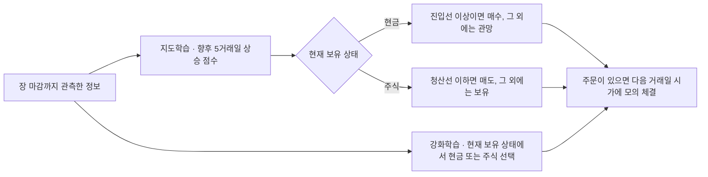

# 졸업논문 · 국내 주식 매수·매도 타이밍 시스템

매일 장이 끝난 뒤 **현금이면 언제 사고, 보유 중이면 언제 팔지** 결정하는 시스템을 연구한다. 과거 데이터로 주문과 계좌를 재현해 매수 후 보유, 이동평균 매매, 제안 시스템의 비용 차감 후 성과를 비교한다.

**현재 단계**　연구 설계(2026년 11월 25일). 지도학습과 강화학습의 매매 판단을 동일한 모의계좌·거래비용 조건에서 비교한다. 2025년을 최종 시험으로 두며, 데이터 수집·모델 학습·백테스트는 예정된 작업이다.

[연구 설계 전체 읽기](./졸업논문%20연구설계.md) · [설계 변경 기록](https://github.com/Choi-SeoJun/graduation-thesis/commits/main/)

## 시스템의 하루

## 연구 진행 기록

| 단계 | 확인할 내용 | 상태 |
|---|---|---|
| 연구 설계 | 매수·매도 규칙, 비교 전략, 시간순 검증, 비용 기준 | 초안 작성 |
| 표본·전처리 | 과거 시점으로 고른 종목, 기업행사와 거래정지, 데이터 사전 | 예정 |
| 시스템 검증 | 매수와 매도를 따로 바꾼 결과, 모형·변수별 개선 여부 | 예정 |
| 뉴스 보조 실험 | 보도량과 감성이 실제 주문과 순성과를 바꾸는지 | 예정 |
| 최종 분석 | 기준선 비교, 거래 사례, 그림·표와 재현 방법 | 예정 |

첫 설계에서 고정했던 장중 청산 규칙을 보유 상태에 따라 매일 재평가하는 방식으로 바꿨다. 최초 제안과 개정안은 커밋 이력에서 비교할 수 있다. 실험 단계마다 사용한 데이터 출처·설정·코드·실행 명령과 결과를 이 저장소에 연결한다.
