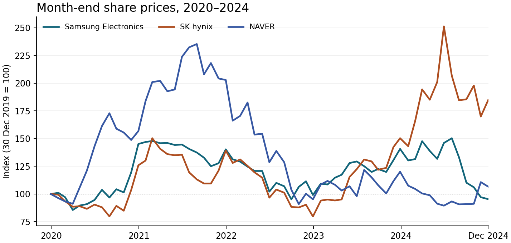

# 학습 전 데이터 점검 결과

개발 기간은 2020년 첫 거래일부터 2024년 마지막 거래일까지다. 아래 표는 데이터와 기준 전략을 점검한 결과다. 지도학습·강화학습 성과는 서버 실험에서 산출한다.

## 종목별 입력

| 종목 | 거래일 | 시세 입력 6개 완비 | 5일 목표 확정 | 상승 목표 비율 | 일간 변동성의 중앙값¹ |
|---|---:|---:|---:|---:|---:|
| 삼성전자 | 1,231 | 1,231 | 1,225 | 47.7% | 1.51% |
| SK하이닉스 | 1,231 | 1,231 | 1,225 | 50.2% | 2.23% |
| NAVER | 1,231 | 1,231 | 1,225 | 49.1% | 2.03% |

¹ 거래일마다 직전 20개 일간 종가수익률의 표본표준편차를 구하고 그 값들의 중앙값을 냈다. 상승 목표는 오늘 판단 후 다음 시가에 매수해 5거래일 뒤 시가가 더 높았던 경우다. 마지막 6거래일은 목표 만기가 2024년을 넘어간다.

각 선은 2019년 말 종가를 100으로 둔 월말 가격이다. 배당·거래비용을 포함한 계좌 수익률은 별도로 계산한다.

## 연도별 시세 및 뉴스

뉴스 완료는 정해 둔 단일 매체·검색 범위에서 해당 종목과 거래일의 집계가 가능하다는 뜻이다. 신규 사건은 같은 계약의 반복 보도를 합쳐 한 번만 센다.

| 종목 | 연도 | 시세 거래일 | 뉴스 완료 | 뉴스 미확인 | 체결 사건 | 해지 사건 | 계약 보도 |
|---|---:|---:|---:|---:|---:|---:|---:|
| 삼성전자 | 2020 | 248 | 245 | 3 | 7 | 0 | 7 |
| 삼성전자 | 2021 | 248 | 247 | 1 | 15 | 0 | 15 |
| 삼성전자 | 2022 | 246 | 246 | 0 | 14 | 0 | 13 |
| 삼성전자 | 2023 | 245 | 244 | 1 | 7 | 0 | 4 |
| 삼성전자 | 2024 | 244 | 242 | 2 | 0 | 0 | 0 |
| SK하이닉스 | 2020 | 248 | 247 | 1 | 3 | 0 | 3 |
| SK하이닉스 | 2021 | 248 | 248 | 0 | 12 | 0 | 12 |
| SK하이닉스 | 2022 | 246 | 246 | 0 | 5 | 0 | 5 |
| SK하이닉스 | 2023 | 245 | 244 | 1 | 1 | 0 | 1 |
| SK하이닉스 | 2024 | 244 | 244 | 0 | 4 | 0 | 4 |
| NAVER | 2020 | 248 | 247 | 1 | 0 | 0 | 0 |
| NAVER | 2021 | 248 | 248 | 0 | 0 | 0 | 0 |
| NAVER | 2022 | 246 | 246 | 0 | 0 | 0 | 0 |
| NAVER | 2023 | 245 | 245 | 0 | 1 | 0 | 1 |
| NAVER | 2024 | 244 | 244 | 0 | 0 | 0 | 0 |

확인된 입력에 포함한 신규 체결은 삼성전자 43건, SK하이닉스 25건, NAVER 1건이다. 해지 보도는 세 종목 합계 0건이다. NAVER는 학습·검증 구간별로 뉴스 변수가 거의 항상 0이어서 뉴스 효과를 결론 내리기 어렵다. 해지 변수도 관측 사건이 충분해야 방향이나 효과를 해석할 수 있다.

**NAVER 후속 점검**에서 같은 매체가 보도한 2022년 계약 한 건과 2023년 계약의 장중 선행 보도를 찾았다. 표는 기존 제목 검색식으로 만든 입력을 재현한다. 뉴스 실험 전에는 세 종목에 같은 기준을 적용해 사건 수와 최초 사용 가능 거래일을 다시 산출할 필요가 있다. [누락 사례와 원문](data-notes.md#naver-계약-표본의-누락-점검)

일별 범위, 수정 기사 처리와 판단 보류 기준은 [자료·검증 방법](data-notes.md)에 기록했다.

## 학습 자료의 시간 경계

| 검증 연도 | 학습 연도 | 뉴스 제약 없는 가격 표본(종목당, 1일 / 5일 / 10일 목표) | 뉴스 조건과 짝지은 5일 표본(삼성전자 / SK하이닉스 / NAVER) |
|---:|---|---|---|
| 2022 | 2020~2021 | 494 / 490 / 485 | 486 / 489 / 489 |
| 2023 | 2020~2022 | 740 / 736 / 731 | 732 / 735 / 735 |
| 2024 | 2020~2023 | 985 / 981 / 976 | 976 / 979 / 980 |

각 연도의 첫 검증 주문은 직전 거래일 마감에 산출 가능한 신호를 쓴다. 학습 목표가 검증 기간의 시가를 참조하는 행은 학습에서 제외한다.

## 삼성전자 거래원장 예시

2020년 1월 15일 16:14, 엘오티베큠이 삼성전자에 장비를 공급한다는 보도가 나왔다. 삼성전자는 구매자다. 장 마감 후 보도여서 16일 마감에 첫 입력이 되었고, 그때 삼성전자 종가는 60,700원, 직전 20일 평균 대비 거래량은 1.029배였다. 이 예시에서는 16일 마감에 매수, 17일 마감에 보유, 20일 마감에 매도를 지정했다. 시작 자금은 1,000만 원이다. [이투데이 당시 보도](https://www.etoday.co.kr/news/view/1845590)

| 판단일 → 체결일 | 행동 | 기준 시가 | 모의 체결가 | 체결 수량 | 수수료·매도세 | 마감 장부자산 |
|---|---|---:|---:|---:|---:|---:|
| 2020-01-16 → 2020-01-17 | 매수 | 61,900원 | 61,930.95원 | 161주 | 1,495.63원 | 9,896,921.42원 |
| 2020-01-17 → 2020-01-20 | 보유 | 62,000원 | — | 0주 | 0.00원 | 10,074,021.42원 |
| 2020-01-20 → 2020-01-21 | 매도 | 62,000원 | 61,969.00원 | 161주 | 26,439.07원 | 9,978,191.34원 |

슬리피지는 시가 대비 편도 0.05%를 체결가에 반영했다. 매도는 마지막 날 청산 규칙과도 일치한다. 이 예시는 매매 규칙의 수익 예측력을 평가하는 데 사용하지 않는다.

## 단순 전략 재생

1,000만 원을 종목·연도·전략별로 새로 배정했다. 전액 현금, 첫 시가 매수 후 보유, 20일 이동평균, 뉴스가 확인된 날만 판단하는 20일 이동평균을 같은 계좌에서 재생했다. 아래는 3개 검증 연도의 거래비용 차감 후 장부수익률이다. 각 연도의 마지막 거래일 시가에 보유분을 청산한다.

| 종목 | 연도 | 현금 | 매수 후 보유 | 이동평균 | 뉴스 확인일 이동평균 | 연말 미확정 배당 권리가 있는 전략 |
|---|---:|---:|---:|---:|---:|---|
| 삼성전자 | 2022 | +0.00% | -28.15% | -18.94% | -18.94% | 보유 |
| 삼성전자 | 2023 | +0.00% | +41.50% | +1.41% | +4.25% | 보유, 이동평균, 확인일 이동평균 |
| 삼성전자 | 2024 | +0.00% | -30.46% | -22.01% | -22.01% | 보유, 이동평균, 확인일 이동평균 |
| SK하이닉스 | 2022 | +0.00% | -42.14% | -34.59% | -34.59% | 보유 |
| SK하이닉스 | 2023 | +0.00% | +88.19% | -2.25% | -2.25% | 보유, 이동평균, 확인일 이동평균 |
| SK하이닉스 | 2024 | +0.00% | +24.66% | +20.72% | +20.72% | 없음 |
| NAVER | 2022 | +0.00% | -51.69% | -18.23% | -18.23% | 없음 |
| NAVER | 2023 | +0.00% | +24.34% | +25.65% | +25.65% | 보유, 이동평균, 확인일 이동평균 |
| NAVER | 2024 | +0.00% | -11.56% | -14.88% | -14.88% | 없음 |

배당은 개인 소득세 차감 전 금액을 사용했다. 권리가 생겨도 금액이 발표되기 전에는 장부자산에 더하지 않는다. ‘미확정 배당 권리’가 표시된 칸의 경제적 최종 수익은 나중에 확정된 배당에 따라 달라진다. 로컬 기준선 표 `annual.csv`에는 2024년 말까지 뒤늦게 확인된 권리를 더한 사후 수익도 별도 열로 표시했다. 끝까지 미확정이면 빈칸이다. 이 사후 값은 매매 판단·학습 보상에 사용하지 않는다. `cost-sensitivity.csv`에는 편도 슬리피지를 0%, 0.05%, 0.10%로 바꿨을 때의 장부수익·낙폭·거래 횟수를 기록했다.
